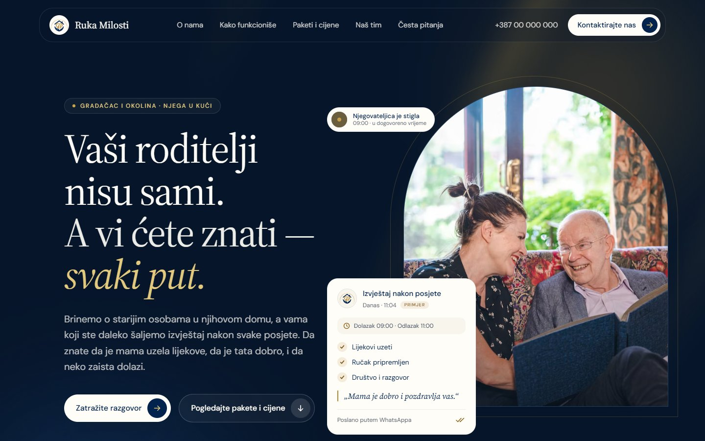
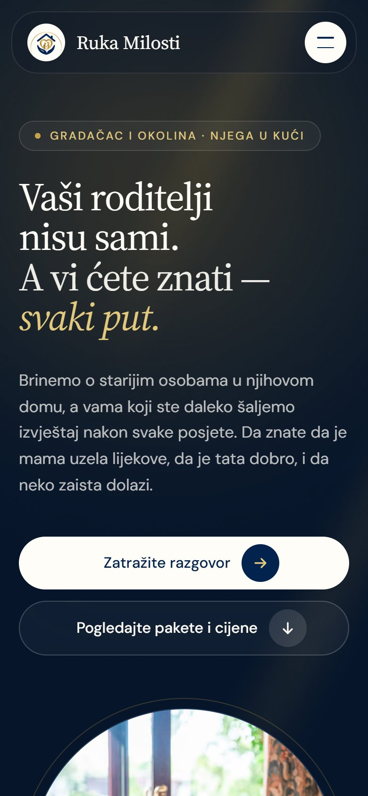

# Ruka Milosti – Website

Website for **Ruka Milosti**, an in-home care service for elderly people in Gradačac, Bosnia and Herzegovina.

The service is local, but the decision to book it is usually made by adult children living in Germany, Austria and Switzerland. They can't visit, meet the caregiver or check in person. So the site has one job: make them feel they can trust these people with their parents' care.

<p>
  
  &nbsp;
  
</p>

**Stack:** React 19 · Vite 7 · TypeScript · Tailwind CSS 4 · sharp (asset generation)

---

## Design decisions

- **The hero shows the product, not a stock scene.** The card next to the headline is an example of the report families receive after every visit: arrival and departure time, what was done and a short note. That report is the core of the service, so it's the core of the page.
- **Built for the real customer.** The "family can be far away, care can be close" section connects Stuttgart, Munich, Vienna and Zürich with Gradačac on an animated map.
- **Brand colours measured from the logo, not guessed.** Navy and gold were sampled from the original logo. Gold is used only as an accent (lines, checkmarks, numbers), never as a surface.
- **Mobile first,** with accessibility and full support for Bosnian characters (č, ć, š, ž, đ) from day one.

## Features

- **Single source of content.** All text, prices, team and contact details live in [`src/data/site.ts`](src/data/site.ts).
- **Design tokens in one place.** Colours, radii, shadows, spacing and typography are defined in the `@theme` block of [`src/index.css`](src/index.css).
- **Contact form** with validation, loading, error and success states. Sending goes through [`src/lib/inquiry.ts`](src/lib/inquiry.ts), the only point of contact with a backend. Without `VITE_CONTACT_ENDPOINT` the form runs in mock mode; with it, it POSTs JSON to that URL.
- **Generated brand assets.** `npm run assets` builds the logo variants, favicons, Apple touch icon and Open Graph image from the single source logo with sharp ([`scripts/generate-assets.mjs`](scripts/generate-assets.mjs)).
- **Animations without libraries.** Plain CSS and a few small hooks: staggered hero entrance, mouse parallax (desktop only), word-by-word text reveal on scroll, a sticky "how it works" timeline and an infinite service ticker.

## Accessibility

- Semantic HTML, one `<h1>`, a clean heading hierarchy and a "skip to content" link
- FAQ accordion with `aria-expanded` / `aria-controls` and full keyboard support (Enter, Space, ↑ ↓, Home, End)
- A `<label>` for every form field, `aria-invalid`, `role="alert"` on errors, and focus moves to the first invalid field
- Visible focus ring across the site
- `prefers-reduced-motion` turns off all animation, parallax and map movement
- No horizontal scroll from 320 to 1920 px

## Brand tokens

| Token | Value | Role |
|---|---|---|
| `--color-navy-900` | `#01234D` | Primary colour from the logo |
| `--color-navy-950` | `#061529` | Footer and darkest blocks |
| `--color-gold-500` | `#B38630` | Average of the logo's gold surfaces, used as the accent |
| `--color-gold-700` | `#7A5413` | Gold for small text (6.2:1 contrast on cream) |
| `--color-cream-100` | `#F8F5ED` | Base background |
| `--color-ink-muted` | `#5D6570` | Secondary text (5.4:1 contrast) |

Fonts: Source Serif 4 for headings and DM Sans for body text, both with full `latin-ext` support.

## Project structure

```
src/
  data/site.ts        all page content
  index.css           design tokens
  lib/                inquiry (backend layer), validation, typography helpers
  hooks/              useReveal, useScrollProgress, useParallax
  components/
    ui/               Button, Field, ImageFrame, ReportCard, Reveal, …
    sections/         Navbar, Hero, Distance, About, HowItWorks, Pricing, Team, Faq, Contact, Footer
scripts/
  generate-assets.mjs logo, favicon and OG image generation
Resursi/Logo.png      original logo, the source for all brand assets
```

## Running locally

```bash
npm install
npm run dev        # development server
npm run build      # production build to dist/
npm run preview    # preview the production build
npm run lint       # TypeScript type check
npm run assets     # regenerate logo, favicons and OG image
```

`npm run build` produces a static `dist/` folder that works on any static host (Netlify, Vercel, Cloudflare Pages or classic hosting).

## Status

Before launch, the client still needs to confirm phone numbers, prices and team names, and supply real photos. The photos in the current build are Unsplash placeholders, and every placeholder value is marked with `TODO` in `src/data/site.ts`.
